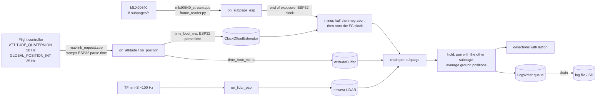

# Code walkthrough

How the Pillar B code fits together, generated from the code as it stands
on 2026-09-28, with the clock mapping (`clock_sync.py`) added on 2026-09-30. It replaces an earlier walkthrough that described five files
and a detector that no longer exists. If this file and the code disagree,
the code is right and this file is stale: fix it rather than trusting it.

Every number quoted here was measured from the current code, and the section
it came from is named, so it can be re-measured.

---

## 1. What the system does

A thermal camera (MLX90640, 32 x 24 pixels) looks down and forward from a
search-and-rescue UAV. When a warm object appears, the code turns its pixel
position into a latitude and longitude, using the aircraft's attitude from
the flight controller and its height from a LiDAR rangefinder.

The Python in `PillarB/` is the reference implementation and the test bed.
The firmware in `PillarB/firmware/` runs on the ESP32 mission computer and
feeds it. `orchestrator.py` is the file the eventual C++ translation
translates, because it is the one place that says in what order things
happen.

## 2. Repository map

| File | Role |
|---|---|
| `pillar_b.py` | The six-step transform, pixel to ground offset to lat/lon. Library. |
| `centroid_detector.py` | Finds warm regions: threshold, connected components, one centroid per region. |
| `synthetic_frames.py` | Fake 24 x 32 frames with a Gaussian blob. Stands in for the camera in tests. |
| `frame_reader.py` | Reads the real camera stream, runs the Melexis compensation, yields the same frames. |
| `attitude_interpolator.py` | Ring buffer of attitude samples, SLERP to any timestamp, refuses to extrapolate. Hand written, frozen. |
| `clock_sync.py` | Maps the ESP32's clock onto the flight controller's, and says which instant a subpage describes (its exposure midpoint). |
| `orchestrator.py` | The runtime order. Per-subpage attitude, pairs subpages, logs. |
| `logformat.py` | Binary per-frame log with CRC, a bounded write queue, a resyncing reader. |
| `testdata/mlx90640_melexis_example.json` | Melexis example sensor data (Apache-2.0), the golden vector for `frame_reader.py`. |
| `testdata/LICENSE-APACHE-2.0` | Full Apache 2.0 text, for that data and for the Melexis port in `frame_reader.py`. |
| `firmware/platformio.ini` | One PlatformIO project, one environment per ESP32 program. |
| `firmware/src/mlx90640_stream.cpp` | ESP32: raw MLX90640 words to the laptop at 921600 baud. Built as `pillarb_stream`, also runs the FC link and sends every attitude message with both clocks. |
| `firmware/src/mavlink_request.h/.cpp` | ESP32: configures the flight controller's MAVLink output and decodes it. |
| `firmware/src/mavlink_request_main.cpp` | ESP32 harness for the above, against a real FC or SITL. |
| `firmware/src/sd_check.cpp` | ESP32: mounts the SD card, preallocates, times batch writes, verifies the read-back. |
| `firmware/include/secrets.example.h` | Template for WiFi credentials used by the SITL build. |
| `Bench tests/LIDAR over seawater/esp32-logger/src/main.cpp` | ESP32: TFmini-S frames to CSV over USB, for the Phase 0 bench test. |
| `Bench tests/LIDAR over seawater/csv pc capture.py` | Laptop: captures that CSV, 200 samples per rig position. |
| `Bench tests/LIDAR over seawater/analyze lidar.py` | Laptop: Phase 0 analysis, dropouts, boresight fit, surface/bottom verdict. |

The brief also lists `combine_csvs.py`; it is not in the repository at the
time of writing.

Test suites are in section 6.

## 3. Runtime order

Three sensor streams arrive independently and none waits for another.
Attitude and LiDAR are stored as they arrive. A thermal subpage arriving is
what triggers the work. For each subpage from the real camera,
`Orchestrator.on_subpage_esp()` first:

0. Moves the subpage's timestamp from the end of its exposure to the middle
   (minus `EXPOSURE_MID_OFFSET_US`, 62.5 ms at 8 Hz), then from the ESP32's
   clock to the flight controller's with the current clock estimate
   (section 4.6). If there is no valid estimate (the first seconds after
   boot, after a restart, with the link silent) the subpage is refused and
   counted in `rejected_no_clock_sync`. No zero or remembered offset is ever
   substituted.

Then, and directly for `on_subpage()`, whose callers (tests, synthetic
replays) already have one clock:

1. Gives the log writer a clock tick (`drain_if_older_than`, section 4.8).
2. Evicts a held subpage that has waited longer than `PAIR_TIMEOUT_MS`
   (250 ms) or whose partner will never come because the same subpage index
   arrived again. The evicted half is returned unpaired, never discarded.
3. Looks up the attitude at this subpage's own timestamp. If the
   interpolator refuses (too old, too new, gap too wide), the subpage is
   dropped and counted. The newest attitude is never substituted: that would
   turn a counted failure into an invisible bias.
4. Checks the newest LiDAR reading: missing, older than `LIDAR_MAX_AGE_MS`
   (100 ms), or outside the rangefinder's valid band or tilt cone. Each case
   has its own counter.
5. Projects the LiDAR slant range onto the vertical.
6. Detects warm regions and transforms each to a ground offset.
7. Holds the result until the other subpage of the frame arrives, then
   associates detections by nearest ground position within
   `PAIR_MAX_ASSOC_M` (0.5 m), averages the matched ground positions,
   converts to lat/lon, and logs one record for the complete frame.

Why subpages matter. The MLX90640 reads two interleaved halves (a
chessboard by default), and its refresh setting is per subpage: 8 Hz gives
8 subpages and 4 complete frames per second, the two halves 125 ms apart.
Each half gets its own attitude lookup, and the two ground positions, not
pixel positions, are averaged. The halves were transformed with different
attitudes, so their pixel coordinates are not in a common frame; only north
and east are comparable. Averaging cancels the subpage skew to first order.
It does not cancel the exposure-midpoint offset of step 0: both halves are
stamped at the end of their own exposure, so both carry that bias in the
same direction and the average keeps it. Averaging removes the difference
between the halves, not an error they share, which is why step 0 subtracts
it from each subpage (`test_orchestrator.py` section N: 7.3 cm at 30 deg/s
without it, 0.4 mm with it).

`close()` returns anything still held, as unpaired detections, and keeps it
in `results_at_close`, so a target seen only in the last subpage before
shutdown is not lost.

## 4. Modules

### 4.1 `pillar_b.py`, the transform

Six steps: pixel to camera ray (`pixel_to_ray_camera`), camera to body
(`mounting_matrix`, a fixed axis remap plus the 12.5 deg forward tilt),
body to NED (`quaternion_to_rotation`), lever arm, ground intersection
(`pixel_to_ground_ned`), and NED offset to lat/lon (`ned_to_latlon`, with
the cos(latitude) term that matters this far north: at 69.97 N a degree of
longitude is 38 km, not 111 km).

`height_m` is the flight controller's height above ground, not the
camera's. The function subtracts the lever arm's vertical component itself.

Constants: `F_U` and `F_V` are the focal lengths in pixels, computed from
the datasheet field of view, and `LEVER_ARM_B` is the camera's offset from
the flight controller. Neither may be changed by hand (see section 7).
`lidar_is_valid()` rejects slant ranges outside 0.3 to 11 m or more than
15 deg of tilt.

### 4.2 `centroid_detector.py`, finding targets

`detect_centroids(frame)` returns a list of dicts with `u`, `v`,
`n_pixels`, `snr`, `touches_edge`, largest region first. It thresholds at
the larger of the old adaptive threshold and a contrast floor
(`background + contrast_sigma * noise`, with background and noise from the
median and MAD so a target does not inflate them), labels connected regions
with `scipy.ndimage.label`, keeps regions of 5 to 100 pixels, and computes
each centroid weighted by temperature above background. `detect_centroid()`
is the single-result wrapper kept for old callers; new code uses the plural.

`snr` is a plain ratio, peak above background over noise sigma, not
decibels.

### 4.3 `synthetic_frames.py`

`create_synthetic_frame(u, v)` returns a (24, 32) float frame: a Gaussian
blob (amplitude 20, sigma 1.5 px) on a 15-unit background with 0.5 noise.
Rows are v, columns are u.

### 4.4 `frame_reader.py`, the real camera

Reads the byte stream from `mlx90640_stream.cpp`, live from a serial port
(`iter_serial`, which can also save every raw byte) or from a saved capture
(`iter_file`), and yields `Subpage` tuples whose `frame` has exactly the
shape `synthetic_frames.py` produces. Nothing downstream changes.

`StreamParser` finds packets by magic (`MLXS` subpage, `MLXE` EEPROM,
`MLXT` text, `MLXA` attitude pair), checks the length for the type and the CRC32, and resyncs one
byte later on any failure. Every byte not inside a valid packet is counted
in `bytes_discarded`; a rising count is how a bad cable is diagnosed.

The compensation is a line-by-line port of the Melexis reference driver
(`MLX90640_API.c` at commit `f6be7ca`): `extract_parameters`, `get_vdd`,
`get_ta`, `calculate_to`, `bad_pixels_correction`. Parameter extraction
reproduces the C's float32 rounding, because its results are quantized to
integers where a different rounding could flip a value. Checked against
Melexis's own example data: every calibration parameter and all 768 pixel
offsets match exactly, and all 768 temperatures match within 0.6 mK
(`test_frame_reader.py` section A).

Behaviour kept from Melexis, but counted: auxiliary words reading `0x7FFF`
are replaced by the previous subpage's (`aux_invalid`); pixel lines
reading `0x7FFF` skip the subpage (`frame_data_invalid`). Departure from
Melexis: its rescaling loops never end on an all-zero kta/kv or a
non-positive alpha. Here they stop and the EEPROM is rejected
(`eeprom_invalid`) instead of hanging.

The first subpage after start-up is not yielded (`warmup_subpages`): half
the image has never been measured yet. Subpages that arrive before any
EEPROM packet are held (up to 64) and processed when it arrives.

Defaults: emissivity 0.95 and reflected temperature `Ta - 8`, the values
Melexis's examples use for open air.

Timestamps are passed on raw: `time_us` is the ESP32's `micros()` at the
data-ready flag, the END of the exposure, unwrapped past the 32-bit wrap.
Converting it is the orchestrator's job, at lookup time. Every subpage's
control register is checked against `clock_sync.SUBPAGE_RATE_HZ`, the rate
the exposure correction is derived from; a sensor at any other rate is
counted in `refresh_rate_mismatch` (the subpage is still yielded).

From the `pillarb_stream` build the stream also carries `MLXA` packets, one
per attitude message, with the message's `time_boot_ms` and the ESP32's
`micros()` when it was parsed. `feed_events()` returns them as
`AttitudePair` tuples interleaved with the `Subpage`s in stream order, and
`drive(events, orch)` hands both to the orchestrator in that order.
`feed()` still returns only subpages and counts the pairs it cannot return
(`attitude_ignored_by_feed`). Subpages and pairs share one unwrapped clock;
the unwrap picks the value nearest the newest time seen, because a subpage
is stamped before its 40 ms I2C read and attitude parsed during the read is
sent first. Attitude sequence gaps (`attitude_lost`), firmware restarts and
Euler-fallback samples (`attitude_from_euler`) are counted.

### 4.5 `attitude_interpolator.py`

`AttitudeBuffer.add(t_ms, q)` stores samples in a fixed ring buffer and
rejects duplicate or backwards timestamps. `at(t_ms)` returns the SLERP
between the two samples bracketing `t_ms` (NLERP when they are nearly
identical, where SLERP's division is unreliable), or `None` when `t_ms` is
outside the stored window or the bracketing gap exceeds `max_gap_ms`. Four
counters record why. It handles the quaternion sign ambiguity (q and -q are
the same rotation). Frozen: use it, do not change it.

### 4.6 `clock_sync.py`, two clocks and the exposure midpoint

Attitude is stamped by the flight controller (`time_boot_ms`, ArduPilot's
`AP_HAL::millis()` when it packs the message), subpages and LiDAR by the
ESP32 (`micros()`). Every attitude message is logged with both clocks: its
own `time_boot_ms` and the ESP32's `micros()` when it was parsed. Attitude
is stored against `time_boot_ms` only; arrival time carries the link's
jitter and is never written into the attitude record. The subpage's time is
converted from the ESP32 clock to the FC's at lookup time, so the uncertain
step lives in this one module and a better estimate can be recomputed from
a saved raw capture without changing any log format.

`ClockOffsetEstimator` takes one pair per attitude message. For each,
`d = esp_rx_us - 1000 * time_boot_ms - wire time` is the offset plus a
latency that varies and is never negative, so the estimate comes from the
fastest arrivals, not the mean: the 5th percentile of `d` in each one-second
bin, with a line fitted through the last 20 bins so crystal drift is tracked.
The wire time of each message (its length at the link's baud rate) is
subtracted exactly first. A bin more than 2 ms above the line through the
others is dropped as congested, since latency only pushes `d` up. A slope
beyond 500 ppm is refused, checked first with a slope one bad bin cannot
move. A pair more than 2 ms below the line is impossible and rejected; 20
of those within a second mean the offset stepped, and the estimator starts
over. It also starts over on a flight controller reboot (`time_boot_ms`
back by a second or more) or an ESP32 restart.

Why 20 bins and not a few. Each bin's percentile scatters by about 150 us.
Through six bins the slope is uncertain by about 60 ppm, more than the
drift it is meant to capture, and the result was no better than a flat
offset. Through twenty it is good to a few ppm.

With no valid estimate, `to_fc_ms()` returns `None` and counts why
(`rejected_no_estimate`, `_before_epoch`, `_too_old`, `_stale`). That is the
state for about three seconds after boot or a restart, and once the
attitude stream has been silent for a second. Nothing ever falls back to a
zero or remembered offset, which would give plausible wrong positions.

Measured on a simulated link (`test_clock_sync.py`): 0.65 ms mean error,
0.10 ms spread, 0.85 ms worst, where the mean of `d` is 11.2 ms out. A 50
ppm drift over ten minutes changes nothing; an offset measured once at boot
would be 29 ms out by then.

The same module holds the subpage's own timing. `SUBPAGE_RATE_HZ` (8,
matching the firmware) gives `SUBPAGE_INTEGRATION_US` (125 ms, assumed to
be the whole subpage period), and `EXPOSURE_MID_OFFSET_US` is half of it,
62.5 ms, the distance from the data-ready flag back to the middle of the
exposure.

### 4.7 `orchestrator.py`

See section 3 for the order. Constants and why they have their values:

| Constant | Value | Reason |
|---|---|---|
| `LIDAR_MAX_AGE_MS` | 100 ms | Ten missed TFmini readings at ~100 Hz. Bounds stale-height error to about 2 cm at the boresight. |
| `PAIR_MAX_ASSOC_M` | 0.5 m | 2.4x the 0.208 m localisation budget: tolerates one bad centroid, refuses two targets 0.5 m apart. |
| `PAIR_TIMEOUT_MS` | 250 ms | Two subpage intervals at 8 Hz. |
| `LOG_MAX_PENDING_MS` | 1000 ms | The loss bound the SD batch size is sized against. |
| `clock_sync.EXPOSURE_MID_OFFSET_US` | 62.5 ms | Half a subpage integration at 8 Hz. The constructor takes it as a parameter so a bench measurement can replace it. |

Two entry points per sensor. `on_subpage()` and `on_lidar()` take times
already on the flight controller's clock (tests, synthetic replays).
`on_subpage_esp()` and `on_lidar_esp()` take the ESP32's `micros()`, which
is what the real hardware produces; the LiDAR is aged against the subpage
on the ESP32 clock, with no estimate involved. Mixing the two clocks
raises. `on_attitude(..., esp_rx_us=, wire_bytes=)` feeds the clock
estimator as well as the attitude buffer.

A flight controller reboot (attitude `time_boot_ms` back by a second or
more) replaces the attitude buffer with a fresh one, carrying its counters
over. Without that, the frozen buffer refuses every later sample as out of
order until `time_boot_ms` passes its pre-reboot value: an outage as long as
the previous uptime (`test_orchestrator.py` section O: all 450 samples of a
9 s run). The reboot also resets the clock estimate, emits the held half
unpaired, forgets the position fix, and drains the log.

`counters()` returns every counter, including the interpolator's four, the
clock estimator's under a `clock_` prefix and the log writer's under a
`log_` prefix. Every rejection path has one, `rejected_no_clock_sync`
included. The log keys are present, as `None`, even with logging off, so
telemetry has one schema.

### 4.8 `logformat.py`

One fixed-size binary record per paired frame (3132 bytes): magic,
timestamp, subpage, 768 float32 pixels, LiDAR distance and strength,
attitude quaternion, lat/lon/alt, CRC32. The layout is frozen.
`read_frames()` scans for the record magic, so a torn or corrupted record
costs only itself. It reports corruption, a torn tail, trailing 0x00/0xFF
padding, and timestamps going backwards or jumping forward more than
`TIME_GAP_MS`, each flagged and never filtered. `to_csv()` converts a log
for reading without this code.

`LogWriter` is a producer/consumer pair, because on the ESP32 the two run on
different cores. `write_frame()` only enqueues and never blocks; if the queue
is full it refuses the newest record and counts it. `drain()` writes
everything queued in one batch with one fsync. Modes: the default
(`batch_records=1`) drains every record immediately, the laptop behaviour;
`batch_records=SD_BATCH_RECORDS` (4) writes in batches, the SD behaviour;
`auto_drain=False` leaves draining to a separate thread or task, the ESP32
structure.

What a power loss costs in SD mode: at most the records still queued, one
second at 4 records per second, including when records stop arriving
(`drain_if_older_than`). A device that fails mid-flight is counted
(`write_failures`), and the next drain resumes at the exact byte where the
previous one stopped, so nothing is duplicated. A failed fsync is counted
(`records_unsynced`) and retried. `close()` holds the drain lock throughout,
so it cannot race a writer thread.

The module docstring holds the ESP32 port contract: SdFat and exFAT, 64 MB
preallocation, the mandatory erase of the preallocated range at boot, the
landing truncate to `file_bytes`, the core 0/core 1 task split, and which
data stays in internal flash.

### 4.9 `firmware/src/mlx90640_stream.cpp`

Polls the MLX90640 status register over I2C at 400 kHz and, on each new
subpage, reads the full 832-word RAM image and the control register, the
same data the Melexis driver's `MLX90640_GetFrameData` collects. It sends
them with the ESP32 timestamp of the data-ready flag, a sequence number, and
its own counters (I2C errors, missed subpages, packets dropped because USB
could not keep up). The EEPROM goes out at boot and every 5 s. It sets the
refresh rate to 8 Hz per subpage at every boot, because that register reverts
at power-up.

Why 921600 baud: one subpage packet is 1702 bytes, 13.6 kB/s at 8 Hz, which
does not fit at 115200. Why 400 kHz I2C: at 100 kHz one subpage read takes
longer than the 125 ms between subpages.

Built as `env:pillarb_stream` (`-DPILLARB_WITH_MAVLINK`), the same program
also runs the FC link of 4.10 on UART1 and sends every attitude sample as
an `MLXA` packet with both clocks. One program, so one `micros()` stamps
both the subpages and the attitude: the clock mapping needs that, and the
separate `mlx90640_stream` and `mavlink_request` programs, possibly on two
boards, cannot provide it. The link is polled between the 128-byte I2C
chunks of every read, so an attitude message waits about 3 ms at most to be
stamped, not the 40 ms of a whole RAM read. The blocking stream setup runs
only once an FC heartbeat has been heard, so a bench without an FC keeps
streaming frames; each setup pauses the camera for a few seconds, and an
`MLXT` packet reports how long.

### 4.10 `firmware/src/mavlink_request.cpp`

At start-up, and again whenever the flight controller reboots or attitude
stops:

1. Waits for the FC heartbeat and takes its system and component id from it.
2. Sends `REQUEST_DATA_STREAM` (all streams, off). ArduPilot applies this to
   the port it arrives on, so it zeroes the stream groups of exactly the
   ESP32's port without knowing which one that is. It must come first:
   zeroing a stream group resets the intervals of the messages in it.
3. Requests `ATTITUDE_QUATERNION` at 50 Hz with `SET_MESSAGE_INTERVAL` in a
   `COMMAND_LONG`, one command at a time, retrying with the confirmation
   field incremented. A firmware that only takes `COMMAND_INT` answers with a
   specific code, and the request is resent that way.
4. Measures what actually arrives. If the quaternion was refused, never
   acknowledged, or never arrives, it falls back to `ATTITUDE` (Euler
   angles), converts it to a quaternion, and says so on the serial log, in
   the counters, and as a `STATUSTEXT` the ground station sees.
5. Requests `GLOBAL_POSITION_INT` at 25 Hz and `DISTANCE_SENSOR` at 10 Hz.

`poll()` decodes incoming messages, counts parse errors (bad CRC means bad
bytes on the wire), FC sequence gaps (lost messages), link losses and
attitude stalls, and sends the module's own heartbeat. It uses the
`ardupilotmega` dialect: with `common`, ArduPilot-specific messages would
fail their CRC check and look like cable faults.

Every `AttitudeSample` carries `rx_us`, the ESP32's `micros()` taken the
moment `mavlink_parse_char()` completes the message, and `wire_bytes`, the
message's length on the wire (MAVLink 1 or 2, after MAVLink 2's
trailing-zero truncation, signature included), from which the laptop
computes the part of its latency known exactly.

### 4.11 `firmware/src/mavlink_request_main.cpp`

A test harness around 4.10. `env:mavlink_request` talks to a real FC on
UART1 (GPIO32 RX, GPIO33 TX). `env:mavlink_request_sitl` talks to
ArduPilot SITL on the PC over WiFi TCP, using `include/secrets.h`. Once a
second it prints the measured rate of each message, the latest attitude and
the link counters. The expected output is in `HARDWARE_GUIDE.md`.

### 4.12 `firmware/src/sd_check.cpp`

A pre-flight check of the SD card, not the flight logger. It mounts the
card with SdFat, reports size and filesystem, preallocates a file and
checks it is contiguous, writes 1 MB in 12.5 kB batches with a sync after
each while timing every one, reads it back and verifies it. The worst batch
time is the figure to compare against the 4 s the flight logger's RAM queue
can absorb.

### 4.13 Bench-test code (Phase 0 LiDAR over seawater)

`esp32-logger/src/main.cpp` emits every checksum-valid TFmini-S frame as a
CSV line, dropouts included, and blinks the LED while frames arrive.
`csv pc capture.py` captures those lines, 200 per rig position, with the
angle, height and condition typed in at the rig. `analyze lidar.py`
produces per-burst summaries, a boresight fit, and the surface-versus-bottom
verdict. Capture and parsing are lossless; filtering happens in analysis.

## 5. Error budget

From `test_pillar_b.py` section E, 20,000 Monte Carlo runs, target at frame
centre, 5 m altitude:

| Source | Assumed | RMS contribution |
|---|---|---|
| Attitude noise | 1 deg per axis | 0.127 m |
| Pixel centroid | 0.5 px | 0.107 m |
| Height | 0.06 m | 0.013 m |
| Latency, stale position | 50 +- 20 ms at 3 m/s | 0.161 m |
| Latency, stale attitude | same delay, 30 deg/s about a random axis | 0.120 m |

| Combined | Mean | p95 |
|---|---|---|
| Without latency | 0.148 m | 0.291 m |
| With stale position only (the figure before F4) | 0.208 m | 0.393 m |
| With both, one shared latency draw (correlated) | 0.230 m | 0.458 m |
| With both, independent draws | 0.234 m | 0.447 m |

At a fixed 50 ms lag and 30 deg/s, stale attitude costs 0.138 m about
pitch, 0.131 m about roll and 0.029 m about yaw. Yaw is small because
rotating about the vertical barely moves a point beneath the aircraft:
near the frame centre, heading accuracy matters far less than tilt
accuracy. The rotational term doubles when height doubles; the translation
term does not depend on height at all.

The correlated and independent cases have the same RMS (0.202 m for the two
latency terms together), because the directions of travel and rotation are
unrelated and the cross term averages out. The correlation shows up in the
tail. When a manoeuvre lines the two errors up they add linearly, 0.282 m,
and that is the figure to plan against for such manoeuvres.

The two latency rows assume 50 +- 20 ms because nothing mapped the ESP32
clock onto the flight controller's when they were written. With
`clock_sync.py` and the exposure correction in place, the timing error of
an attitude lookup is the sum of the residuals listed in section 7: about
1 ms from the clock mapping on a simulated link, whatever error the 62.5 ms
exposure assumption carries, and up to one ArduPilot main loop between the
AHRS sample and its stamp. The stale-position term is separate and stays up
to 40 ms, because position is not interpolated. The table is left as it is
until section 8's bench measurements replace the assumptions with numbers.

## 6. Tests

| Suite | Checks | What it proves |
|---|---|---|
| `test_pillar_b.py` | 29 | Hand-computed geometry, lever arm, geodesy, the error budget above. |
| `test_full_pipeline.py` | 100 frames | Synthetic frame to detection to ground position, 0.068 m median. |
| `test_attitude_interpolator.py` | 20 | SLERP correctness, sign flip, refusal, ring wraparound. |
| `test_logformat.py` | 39 | Bit-identical round trip, torn and corrupt files, buffered mode, crash and device failure, concurrency. |
| `test_orchestrator.py` | 77 | Runtime order, pairing, timeouts, every rejection counter, log counters; the real camera path on two clocks, the exposure midpoint, FC reboot, link loss. |
| `test_frame_reader.py` | 47 | The Melexis port against Melexis example data, framing, robustness, bad pixels; attitude pairs, stream order, the shared clock unwrap, a capture driven end to end. |
| `test_clock_sync.py` | 34 | The clock mapping: no estimate means refusal, accuracy under jitter against the mean, drift, FC reboot, ESP32 restart, every rejection path. |

The first five are the suites the brief requires after every task; the
sixth was added with F3 and the seventh with the clock mapping. Run each from `PillarB/` with the project's Python.
Each prints `N/N checks passed` and exits non-zero on any failure.

## 7. Limitations

Measured or known, and not yet resolved:

- **`F_U` and `F_V` disagree by 19.2 %**, which is geometrically impossible
  for square pixels behind one lens: one datasheet field-of-view figure is
  defined differently or rounded. Pending bench calibration with
  `calibrate_intrinsics()`. Do not adjust them by hand.
- **`LEVER_ARM_B` is a placeholder** (5 cm forward, 4 cm down) pending CAD
  measurement.
- **`min_pixels = 5` is a detection cliff.** Detection is 100 % at a blob
  sigma of 1.2 px, 74 % at 1.1, 21 % at 1.05 and 1 % at 1.0, crossing 50 %
  near 1.08 px (400 trials each). A fixed-size target shrinks in pixels as
  altitude rises, which puts a ceiling near 5.8 m on a head-and-shoulders
  target (about 1.4 px sigma at 5 m). The test altitude is 5 m, so the
  margin is under a metre, and the threshold was not set from measured data.
- **`contrast_sigma = 6.0` is a second cliff.** At 0.5 K noise, detection is
  0.2 % at 3 K of apparent contrast, 18 % at 4 K, 88 % at 5 K and 100 % at
  6 K (400 trials each). Also not set from measured data.
- **Edge truncation** biases a target at the frame boundary inward by
  0.44 px, 7.4 cm on the ground at 5 m. Flagged by `touches_edge`, not
  corrected, and not correctable by reweighting, since the missing pixels
  carry no information.
- **The edge flag is conservative.** It marks the outer two-pixel ring, so
  the unflagged interior is 72.9 % of the frame.
- **Subpage averaging cancels the 125 ms subpage skew, not latency, and not
  the exposure midpoint.** Both halves share those, so the average keeps
  them. The exposure midpoint is subtracted per subpage instead (section 3,
  step 0); the timing residuals below remain.
- **`test_full_pipeline.py`'s 0.068 m median is detection error alone**,
  with the same height and attitude used for truth and estimate. The honest
  field figure is the Monte Carlo's: 0.208 m mean with stale position
  only, 0.230 m with stale attitude as well.
- **The ESP32-to-FC clock mapping has a residual, and it is measured only in
  simulation.** `clock_sync.py` estimates the offset from the fastest
  attitude arrivals, less each message's wire time. What remains is the low
  quantile of the delay above the wire time: `time_boot_ms` truncated to
  whole milliseconds (0 to 1 ms), the ESP32's polling, and any part of
  ArduPilot's delay between stamping and transmitting that no message
  escapes. On the simulated link that is 0.65 ms (0.85 ms worst), a few mm
  at 30 deg/s. On hardware it is unknown until section 8.2 measures it; once
  it is, it can be added to the floor passed to `ClockOffsetEstimator`.
- **A link that is congested all the time looks like an offset.** If the
  FC's transmit buffer never empties (requested rates beyond what the baud
  rate carries, for instance 57600 with more streams than now), every
  message is late by the backlog and no receive-side estimator can tell that
  from a different offset. `mavlink_request.cpp`'s measured-rate warning is
  the symptom to watch. A TIMESYNC round trip would not be fooled, because
  its outbound leg carries no backlog (section 8.3).
- **The exposure-midpoint correction assumes the whole subpage period
  integrates.** `EXPOSURE_MID_OFFSET_US` is half of 1 / `SUBPAGE_RATE_HZ`,
  62.5 ms, on the assumption that a subpage integrates for its whole 125 ms
  and that the data-ready flag rises when it ends. Neither is stated in a
  form this code can check, and a readout that runs row by row would make
  the midpoint depend on the row. Uncorrected, the offset was 7.3 cm at
  30 deg/s (`test_orchestrator.py` section N); an error of 10 ms in it would
  be about 1.2 cm. Section 8.1 measures it.
- **`time_boot_ms` is when ArduPilot packed the message, not when the
  attitude inside it was estimated.** The AHRS value can be up to one main
  loop older than its stamp (2.5 ms at 400 Hz). Nothing on the ESP32 side
  can see this; the end-to-end test in section 8.2 includes it.
- **Frames are refused for about three seconds** after boot, after an FC
  reboot and after an ESP32 restart, while the clock estimate builds up, and
  from one second after the attitude stream stops. By design, and counted in
  `rejected_no_clock_sync` with the reason under `clock_`.
- **FC reboots are detected from attitude only.** A position fix that steps
  back is refused and counted, but only an attitude sample stepping back by
  a second or more resets the buffers and the clock estimate.
- **LiDAR on the real-camera path is the newest reading**, typically about
  100 ms after the exposure midpoint once the correction is applied. That is
  inside the `LIDAR_MAX_AGE_MS` envelope the height error was sized for, but
  a short LiDAR history interpolated to the midpoint would remove it.
- **Nothing streams the TFmini to the laptop yet.** `on_lidar_esp()` exists
  and is tested, but `pillarb_stream` carries only the camera and attitude,
  so a live laptop run has no height source and refuses every frame as
  `rejected_no_lidar` until the TFmini is added to the stream (or the
  orchestrator runs on the ESP32).
- **Each MAVLink stream setup pauses the camera** in `pillarb_stream` for a
  few seconds, at start-up and after every FC reboot, because
  `MavlinkStreamSetup::begin()` blocks. Reported in an `MLXT` packet with the
  duration.
- **`clock_sync.FC_LINK_BAUD` must match the FC link.** It turns each
  message's length into its wire time: 3.8 ms for `ATTITUDE_QUATERNION` at
  115200, 7.6 ms at 57600. A mismatch is a constant error of the difference.
- **Image orientation on the airframe is unverified.** `frame_reader.py`
  returns the sensor's native row order. Whether row 0 is the nose side
  depends on the mounting and must be checked before any ground position is
  trusted (`HARDWARE_GUIDE.md`, MLX90640 step).
- **Position is the newest fix, not interpolated.** At 25 Hz its age adds
  up to 40 ms of translation error. Position velocity is available in
  `GLOBAL_POSITION_INT` but unused.
- **The 30 deg/s angular rate in the budget is a manoeuvring figure.** On a
  steady search leg the stale-attitude term is much smaller. The error
  scales linearly with the rate.
- **None of the firmware has run on hardware.** All five environments
  compile without warnings. `mavlink_request` has not been run against SITL
  or a flight controller, and neither `mlx90640_stream` nor `pillarb_stream`
  has run against a sensor.
- **The flight controller's telemetry ports are at 57600 baud** in the
  saved parameter dump. The firmware defaults to 115200. Either change
  `SERIALn_BAUD` on the FC or build with `-DPILLARB_FC_BAUD=57600`; the
  requested streams use about two thirds of a 57600 link.
- **The FC has no rangefinder configured** (`RNGFND1_TYPE = 0`).
  `DISTANCE_SENSOR` is requested, as the brief asks, but will never arrive.
  Height comes from the TFmini on the ESP32.
- **The SD writer exists only as a Python model and a port contract.** The
  only ESP32 SD code is the pre-flight check in `sd_check.cpp`.
- **Stale records in preallocated SD space** are a FAT32 problem: SdFat
  preallocates FAT32 clusters with whatever an earlier file left there, and
  only an erase at boot prevents a power-loss log from running into an
  earlier flight's records. On exFAT, the card as shipped, preallocated space
  past the last synced write reads back as zeros. The reader flags timestamps
  going backwards and jumping forward, but a stale record that happens to
  follow the last real one closely passes both checks.
- **Reused auxiliary words shift temperatures** by up to 0.07 K for the
  affected subpage, the Melexis driver's own behaviour. They are counted.

## 8. Bench measurements the timing model still needs

Proposed, not yet done. Both use only equipment the bench already has or
can make, and both report their result in the units the code consumes.

### 8.1 The end-of-exposure offset, camera alone

What it measures: how long before the data-ready flag the image was
effectively taken, which is the number `EXPOSURE_MID_OFFSET_US` assumes to
be 62.5 ms. Only the ESP32 clock is involved, so the flight controller and
the clock mapping play no part.

1. A small hot target (a 1 W resistor at about 60 C) on the end of an arm
   on a slow turntable or geared motor, turning at a steady rate in front of
   the camera, 0.5 to 1 m away, so the target crosses the image at about
   10 px/s. The smear during one subpage then stays near one pixel.
2. A hall sensor or light gate on the arm's shaft, wired to a spare ESP32
   GPIO with an interrupt that stamps `micros()`, sent as a text packet. The
   stamps give the arm's angle as a function of ESP32 time, and its rate.
3. For every subpage, fit the target's centroid and convert it to an arm
   angle with the camera's geometry (up to a fixed offset, removed in step
   4). Compare it with the arm angle the index stamps predict at
   `t_ready_us`. The difference divided by the arm's rate is how old the
   image is at `t_ready_us`.
4. Run it turning one way and then the other. The mounting angle between
   camera and turntable enters both runs with the same sign and the timing
   with opposite signs, so the half-difference is the timing alone.
5. Place the target at different radii so that it crosses different rows.
   A delay that depends on the row means a rolling readout, and the
   correction then has to depend on the row too.

Precision: at 10 px/s, a centroid good to 0.1 px is 10 ms per subpage,
and a few hundred subpages per direction bring the estimate below 1 ms. If the result differs from 62.5 ms, put the measured
value in `EXPOSURE_MID_OFFSET_US` with a comment naming the measurement,
rather than changing `SUBPAGE_INTEGRATION_US`.

### 8.2 The whole timing chain, camera and flight controller

What it measures: everything left after 8.1, in one number. That is the
clock-mapping residual, the AHRS-to-stamp delay and anything nobody has
thought of, and it is the latency term of section 5 as it really is.

1. The camera mounted on the airframe as it will fly, the airframe on a
   turntable that yaws it at a steady 20 to 30 deg/s, a hot target fixed on
   the ground 3 to 5 m below or in front, and `pillarb_stream` feeding the
   full pipeline, with a LiDAR reading given directly or a fixed height.
2. The computed ground position of a fixed target should not move. A timing
   error makes it swing around the true position in step with the rotation,
   in the direction of motion: the position error divided by the target's
   apparent ground velocity is the timing error.
3. Yaw clockwise, then anticlockwise. Geometric errors (lever arm, focal
   lengths) enter both the same way and the timing error with opposite signs,
   so the half-difference isolates the timing.

A residual above a millisecond or two, or one that differs between runs,
belongs in the floor passed to `ClockOffsetEstimator`, with this test named
as its source.

### 8.3 TIMESYNC as an independent check (not implemented)

ArduPilot answers a `TIMESYNC` request with `tc1` equal to its own clock, in
nanoseconds, at the moment the request's first byte arrived.
(`GCS_Common.cpp`, `handle_timesync`, uses
`receive_time_constraint_us()`, which subtracts the request's wire time from
the UART's receive timestamp.) `ts1` is echoed back unchanged. If its
transmit buffer is full the request is silently dropped. It also broadcasts
its own `TIMESYNC` request on every link every 10 seconds.

For this system that makes TIMESYNC a check rather than a replacement. Its
outbound leg (ESP32 to FC) carries almost no traffic, so `ts1` against `tc1`
is immune to the FC-side congestion that the attitude pairs cannot see, and
`tc1` has microsecond resolution rather than whole milliseconds. But it
needs the ESP32 to transmit on a link it otherwise only listens to, its
return leg is delayed by ArduPilot's scheduler and transmit queue, and it
measures the clock at a different point in ArduPilot than the attitude
stamp, which is the stamp the lookup actually uses. The attitude pairs arrive
at 50 Hz for nothing and measure exactly the relation the lookup needs, so
they are the estimator; a TIMESYNC request once a second, compared with it,
would detect a congested link or a wrong wire-time floor.
