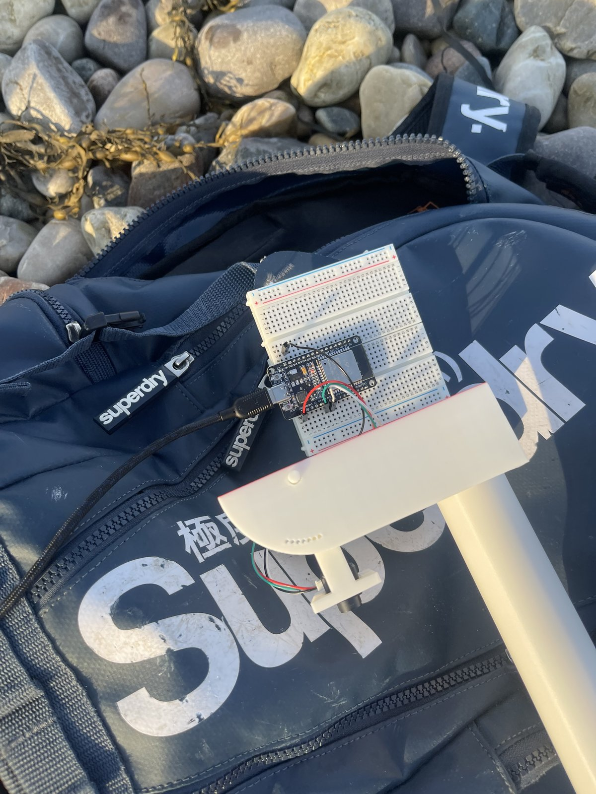
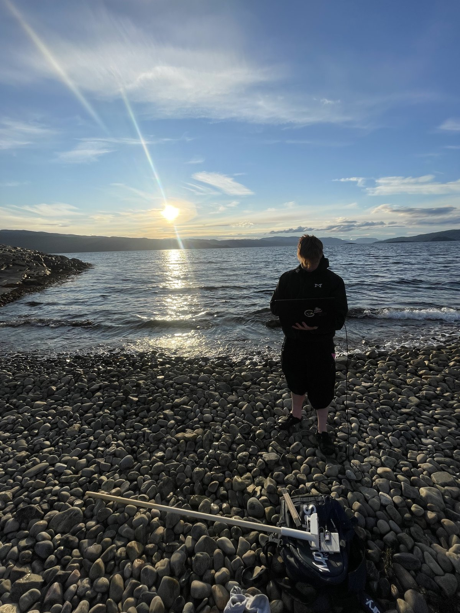
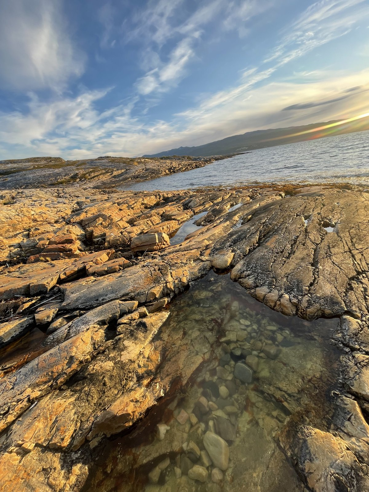

# reddron

This functions as storage for the reddron project. The reddron project name makes a
little more sense if you know the Norwegian word "redde", or "to save". We are trying
to make a drone that finds a person who has fallen into water and drops flotation to
them before a rescue crew can reach the scene.

The design ambition is heavy-weather maritime search and rescue in Finnmark. This
build is a proof of concept flown in benign conditions, but the mission computer is
built to be hardware-agnostic so the same module can move to a larger airframe later.

The reason I picked this problem is that it is one many hear about. Several of my friends
work on maintaing fish farms and king crab boats along the coast, and going overboard is not a
hypothetical, it is a thing that happens. The weather up here turns fast: a workable
morning can become a gale by afternoon, and a deck that was safe an hour ago is suddenly
not. This is water cold enough that survival is measured in minutes rather than hours. 
A person in the sea in Finnmark in winter does not have time to wait for a boat to turn around 
and find them, and the weather that gets people in the water is often the same weather that makes 
them hard to spot.

What surprised me when I started looking was how little exists for this specific case.
There is plenty of drone hardware built for calm-weather inspection and photography,
and there are full-scale SAR aircraft, but the gap in between is wide: something small
enough for a working vessel to carry, tough enough to launch in the conditions that
caused the emergency, and autonomous enough to find a person and drop flotation without
someone piloting it manually while the crew is busy. That gap is what reddron is aimed
at.

## Project structure

The system is split into three pillars:

- **Pillar A: custom airframe and CFD.** Deferred entirely. A scratch-designed airframe
  was out of scope for the timeframe, so this build uses a commercial mark4 7-inch frame.
  Cutting this was a deliberate decision to keep the remaining two pillars achievable at a level worth presenting.
- **Pillar B: thermal target localization.** An MLX90640 thermal array, a TFmini-S
  LiDAR and the flight controller's EKF attitude are fused to convert a hot pixel into
  a GPS coordinate on the ground. This is the core of the project.
- **Pillar C: ballistic payload drop.** A servo-released payload with a lead
  calculation that accounts for forward velocity, drop height and crosswind drag.

The mission computer is an ESP32 that runs Pillars B and C and talks to the flight
controller over MAVLink. Nothing in it is specific to this airframe, which is the
point: the module is the deliverable, the quadcopter is the test platform.

## Bill of materials

**Flight platform**

| Part | Component |
|---|---|
| Frame | Tarot 7" MK4 carbon fiber |
| Motors | 4x iFlight XING X2806.5 1300KV (6S) |
| FC/ESC | MicoAir H743 V2 + 70A AM32 AIO stack |
| GPS/RemoteID | NewBeeDrone BeeID Pro M10 (u-blox M10, IST8310 compass) |
| Radio | RadioMaster Pocket ELRS LBT + XR3 Nano (CRSF, UART6) |
| Props | HQProp 7x3.5x3 |
| Batteries | 2x CNHL 6S 1300mAh 130C, 2x Align HIGHPOWER 6S 2200mAh 45C |
| Charger | ISDT 608AC (50W AC / 200W DC) |

**Mission computer**

| Part | Component |
|---|---|
| MCU | Seeit ESP32-DEV-30P |
| Thermal | Pimoroni PIM365 MLX90640, 55 degree FOV (I2C, 0x33) |
| LiDAR | Benewake TFmini-S, UART |
| Drop servo | DFRobot SER0006 on FC PWM5 |
| Attitude source | EKF quaternion from ArduPilot over MAVLink |

**Printed parts:** eSUN PETG Black for sensor pod, drop cradle and GPS mast. Landing
skids in PETG with TPU feet.

Firmware target is ArduPilot `MicoAir743v2`. Mission computer firmware is built in
VS Code with PlatformIO.

## Development log

**July 2026**

- **July 13:** The idea had been brewing for a while, but I needed to get started on
  actual hardware instead of leaving it as a thought. I used Claude to work
  through component selection. The suggested parts were mostly good, but I had to go
  elsewhere for the flight controller. The first suggestion was the SpeedyBee F405 V5, it has
  no verified ArduPilot target listed on ardupilot.org despite what the norwegian retailer claims.
  [correction from later date, it does have support however i was looking at the wrong flight controller, 
  explained in log for 05.08]
  Lesson taken forward: verify every board directly against ardupilot.org, not against
  a product page.
- **July 14:** Settled on the MicoAir H743 V2 with a 70A AM32 AIO stack. The
  `MicoAir743v2` target is verified and supported from ArduPilot v4.6.0 onward. The
  H743 also gives enough spare UARTs for the ESP32 MAVLink link, which the F405 boards
  were tight on.
- **July 17:** Scoped the project into three pillars and cut Pillar A. A custom airframe
  with CFD validation would have consumed the whole timeline and left the sensor work
  unfinished. Better to have two pillars that work than three that don,t.
- **July 18:** Completed the A1/A3 competency course and exam. Discovered during the
  exam that dropping objects from a drone is prohibited in the open category across all
  EASA member states, Norway included. This forced a redesign of the test plan: the drop
  mechanism gets validated on a static bench rig and indoors, while outdoor flights test
  the localization pipeline without a payload. Registration goes through flydrone.no,
  airspace via NinoxDrone2, and all flying stays outside Alta airport's 5 km control zone.
- **July 19:** Because of yesterday's regulatory setback I thought through
  alternatives and read the full EASA open category rules. Indoor flight falls outside
  the regulatory framework entirely, which opened up real testing options. I work at a
  gym next to an indoor pool, and the local indoor sports hall Finnmarkshallen has the ceiling
  height for testing. Between the two I have venues for both the drop mechanism
  and the localization pipeline without needing a payload drop exemption. I also sent a
  note to the Norwegian aviation authority to double-check my interpretation of the
  indoor exemption (I prefer to not get put onto a list)
- **July 20:** Component procurement locked. I secured that the spec is confirmed compatible.
  Final delivery expected around August 6, limited by shipping from central europe to Finnmark.
- **July 27:** Figured out how the printed parts need to relate to each other
  structurally. The sensor pod, landing gear and drop cradle all bolt to the carbon
  frame independently — none of them should carry load for the others. If landing
  impact travels through the pod it shifts sensor alignment and quietly corrupts the
  Pillar B transform. If it travels through the cradle it risks deforming the release
  geometry. The landing skids are designed to be the part that breaks first in a crash,
  so everything else survives.
- **July 31:** Repository initialized. Firmware skeleton started in PlatformIO.

**August 2026**

- **August 1-2:** Pillar B implemented and verified in software, five files, all tests
  passing:
  `pillar_b.py` — the coordinate transform chain, six steps: pixel to angle, angle to
  body-frame direction vector, body to world frame by quaternion rotation, ground
  intersection using LiDAR slant range, and finally geodetic coordinates.
  `test_pillar_b.py` — six check groups, all passing, plus a 20,000-run Monte Carlo.
  `synthetic_frames.py` — generates fake 32x24 thermal frames with a Gaussian hot spot.
  `centroid_detector.py` — finds the target by weighted centroid, subpixel precision.
  `test_full_pipeline.py` — 100 synthetic frames through detection and transform end
  to end: 100/100 detections, median centroid error 0.072 m.

  Decisions locked:
  Camera orientation: 55 degree FOV cross-track, 35 degrees fore-aft. The wide axis
  goes across the flight path to maximize search width per pass.
  Forward tilt 12.5 degrees from nadir, verified in code: at 12.5 degrees nose-down
  cruise pitch the boresight offset is 0.0 m.
  Ground footprint at 5 m altitude: 3.33 m fore-aft (0.44 m behind to 2.89 m ahead),
  5.20 m cross-track, centered 1.11 m ahead of the drone in hover.
  LiDAR runs continuously, not only in hover. Readings are rejected above 15 degrees
  of tilt or outside 0.3 to 11 m.
  CAD moves to SolidWorks.

  Numbers locked:
  Median localization error at 5 m: ~0.15 m (attitude + pixel + altitude combined).
  Attitude dominates the error budget at 0.128 m RMS; altitude contributes 0.013 m
  RMS, negligible near nadir. Vibration isolation on the flight controller matters
  more to accuracy than a better rangefinder would.
  Calibration check recovers f_u = 29.9 from a true 30.0 under 0.3 px noise.

  Known limitations, written down while they are fresh:
  The 0.072 m pipeline result only measures detection error, since transform and
  ground truth share the same attitude and height. The honest expected field number
  is ~0.15 m from the Monte Carlo, and that is the figure I will quote.
  The datasheet-derived f_u and f_v disagree by 19.2 percent. Bench calibration
  against a measured target is mandatory before trusting real frames.
  The detector cannot report "nothing there". The adaptive threshold always finds a
  max, so an empty frame returns the centroid of a noise cluster. Needs a minimum
  contrast or SNR gate before a detection is declared.
  Targets near the frame edge read biased toward the center, because the Gaussian
  blob is truncated by the frame boundary. This will happen with the real sensor too.
  The SNR printout is labeled dB but the value is a plain ratio. Cosmetic, but
  mislabeled units are the kind of thing that makes a reviewer distrust the rest.
  LEVER_ARM_B is a placeholder until the pod geometry is measured in SolidWorks.
- **August 3-4:** When going through and explaining the project to an older friend of
  mine i was put on the spot beacuse of some dangerous problems. These two days has
  been spent trying to fix the project but still keep the intended purpose. The most
  important change is in even more static bench tests that are verifiable and then fixing
  the coding mistakes. Also, if you look at the code as it stands now putting two people overboard
  or two hotspots, this would make the drone drop and think that there is a person in the 
  middle of them. This sets us a day back and is something that will be corrected. 
  I also found a caveat for what i was saying earlier with the speedybee F405 V5. This flight
  controller did have full ardupilot support however was not actually beeing sold in norway, 
  I was looking at T motor F7 flight controller.
- **August 5:** The day started of with making the preperations needed for the first bench test.
  This first bench test is made to understand the maratime aspect regarding the proof of concept. The 
  background for the check is beacuse of the LIDAR sensors wavelength, for later versions it is smarter
  either way to use radar instead of LIDAR. However, the purpose behind the proof of concept was just that,
  make a working "cheap" proof of concept.
  
  This specific Bench test was completed with a breadboard, the LIDAR sensor, esp32 and a computer to
  directly read off data from the esp32. The purpose of the test is to check if the sensor can detect the 
  seawater and reflect at sealevel, or if it goes straight through.

  The sensor is bolted flat to a rigid plate which pivots against a printed arc. The arc only locks the
  angle, it does not define it, since print tolerance means a hole labelled 12.5 degrees is not actually
  12.5 degrees. The angle is read off a physical protractor sitting on the same plate as the sensor,
  referenced to nadir (straight down) as 0 degrees, and only that reading is logged. Because the arc is
  swept across positions rather than commanded to a target, its print tolerance never enters the data:
  the exact labelled degree does not matter, only the angle actually recorded. The whole plate sits on
  top of a fixed 1.5 m wooden pole, set plumb, so the rig can be placed repeatably and its height
  verified by tape to the water surface. Firmware on the esp32 validates each 9-byte frame and prints
  one CSV line over USB, and all counting and logging happens on the laptop. Signal strength is logged
  for every sample, not just distance, since strength is what separates the cases: a surface return is
  strong and reads the rig height, a bottom return is weak and reads rig height plus depth, and a
  specular reflection away from the receiver reads near zero. Distance alone cannot tell them apart.
  Everything is saved raw, classification happens later in analysis.

  Everything was verified on land first so that anything odd over water belongs to the water and not the
  rig. Frames parse, reported distance matches a tape measure at 1 through 5 m, and a wall sweep from
  minus 20 to plus 20 degrees locates the true boresight. That last step matters because the optical axis
  is not guaranteed perpendicular to the housing, and a degree of offset would shift the whole angle
  series without ever showing itself.

  At the water, 200 samples per point. First the same measured height over shallow and deep water, which
  is the test that actually answers the question. Then incidence angle from 0 to 30 degrees, run out of
  order and with 0 repeated at the end so rig drift becomes visible. The range comes from the aircraft and
  not the mounting, since the LIDAR points along nadir, meaning the incidence angle is just the drone's own
  attitude, capped by ArduPilots default ANGLE_MAX of 30 degrees. Then the same again with ripples, which
  break the specular reflection and may improve angle tolerance while making the nadir return worse. Last,
  a dark floating object in the beam to see whether it returns where bare water does not.

  Distance equal to rig height at both depths means a surface return and a valid height source. Distance
  following the water depth means it reads the bottom, which would require 1550 nm LIDAR if we wished to
  keep the maratime aspect, or a radar altimeter instead. A bimodal result is the awkward one, and the 
  question then becomes whether strength separates the two modes cleanly enough to filter on. All three are 
  valid outcomes, a negative result here is a characterised limit rather than a failure.
- **August 7-8:** Now to the actual tests on the LIDAR sensor. It was done at a shore in Alta (tollevika), 
  evening, low sun. Sensor bolted flat to a stiff plate on the 1.5 m pole, we tested with a angle measure
  and used a spirit level to make sure it was as straight as possible. Height above water taken with a wooden meassure.
  200 samples per point unless noted.
 
  
 
  Ground calibration was done against a wall before leaving, since without it a strange number over water 
  could just as easily be the rig. Tape-measured distances gave 0.8 m -> 82.0 cm (std 0.0), 1.2 m -> 122.0 cm 
  (std 0.0), 2.0 m -> 202.0 cm (std 0.0), 4.0 m -> 409.0 cm (std 0.16), 6.0 m -> 624.1 cm (std 0.41). The three 
  short points are single tape lengths and sit a flat +2 cm over truth. The 4 and 6 m points were chained from 
  a 2 m tape, so the error there lives in the "true" value and not in the sensor; re-measuring the 6 m mark afterwards 
  gave nearer 620 cm, putting that reading at +4 cm. The measuring error also stacked for each 2 meters beacuse i dont
  have a long measuring tape (only 1, 2 meter long). The internal temp read 36 to 41 C throughout, which is the chip 
  self-heating rather than air temperature, so temp_c must not be read as ambient.
 
  

  At the water the sea was rippled with wind chop and stayed that way; no glassy patches were available. Surface return was
  measured at three heights: rig 140 cm -> 141.3 cm, std 2.5, 200/200 valid, strength 4320; rig 130 cm -> 129.3 cm, 
  std 2.9, 200/200, strength 3527; rig 120 cm -> 118.2 cm, std 6.5, 200/200, strength 2286. Distance tracks height to 
  within 2 cm at all three, which is a surface return and a valid height source over rippled sea. Strength sits high, 
  2000 to 4000, because chop scatters light diffusely back instead of mirroring it away.

  The first intended test was to try to find a relatively calm water beeing both deep and shallow 10cm vs 50cm. 
  In the same water it was planned that the "rippled conditions" should also be tested. However the actual sea was 
  never extremely calm so there was a completely stillwater test and then just regular waves. So the calm_shallow
  beeing talked abt in the next paragraph is completely stillwater and not calm like first intended. 
 
  One spot gave the opposite result. In clear shallow water over light rounded stone, rig 125 cm read 153.6 cm, 
  std 0.67, 200/200 valid, strength 784, so the sensor sat 28.6 cm long. The wall calibration puts the sensor 
  within about 2 cm of truth at this range, so the gap is real rather than an artefact of the instrument. Every 
  stone on the bottom was visible by eye through that water, so 850 nm reaches it too, and the 0.67 cm std is 
  the tightest number in the whole set, matching a solid stationary bottom rather than a moving surface. This 
  is a bottom return with roughly 27 cm of water beneath, and the variable is turbidity rather than salt: this 
  was seawater, but crystal clear. Near-shore clear shallow water is therefore a real trap for the height source 
  even though dark deep water is not. The picture under shows the only place where water was "still".
 
  
 
  Incidence angle was swept under ripples, out of order and with 0 repeated at the end so rig drift would show: 0 deg 
  -> 200/200, 126 cm, strength 2672; 5 deg -> 398/400, 123 cm, strength 1501; 10 deg -> 400/400, 137 cm, strength 1285; 
  15 deg -> 200/200, 138 cm, strength 879; 20 deg -> 200/200, 147 cm, strength 391; 25 deg -> 198/200, 151 cm, strength 
  542; 30 deg -> 188/200, 176 cm, strength 335. Validity holds at or near 100 percent out to 25 deg and drops to 94 at 30, 
  but strength collapses from 2672 to 335 across the sweep, so the margin thins badly even while returns stay valid. This 
  is the ripple case, the easy one, so it does not set max_tilt_deg. Absolute distances also run long here: rig height was 
  logged as 110 cm, but the wall calibration says the sensor is accurate at this range, so the sensor actually sat nearer 
  125 cm and the rig-height field was mis-measured by roughly 15 cm. Distance grows faster than h/cos(theta) as well, an 
  angle-dependent long bias under ripples that is worth a closer look.
 
  One early file was discarded. It read a flat ~2000 cm with falling strength and rising dropouts, and the cause was red 
  and white swapped at the sensor, so Vcc drew about 3.3 V off the TX pin instead of 5 V off VIN and the sensor ran browned out. 
  The re-test after fixing the wiring was clean. Two things follow: check power wiring before anything else, and the wall baseline is what separates a rig fault from a real water result, because without it a 20 m reading and a genuine bottom return look equally plausible.
 
  Confirmed by this data: surface return is a valid height source over rippled sea, tracking height within 2 cm across three heights at strength 2000 to 4000, on a fixed +2 cm datum offset with no scale error. Bottom return in clear shallow water over light stone is a genuine near-shore failure of the height source (+28.6 cm, tightest std in the set) and cannot be ruled out.

  Not obtained/not concluded specular return over a flat, calm surface near nadir was never measured, because no glassy water was available. The tilt limit for calm water is therefore left open (max_tilt_deg unset), and behaviour over deeper clear water is untested. These are open items, not implied passes.

  One note on scope. This is the rippled case, the forgiving one, and it passed. That is a real result, but it is a floor rather than a ceiling. The maritime ambition is not ruled out by these findings, but neither is it validated in its harder form: sheltered fish-farm water in a fjord on a cold, windless morning is often mirror-flat, and that is exactly the specular near-nadir case left uncharacterised here. The honest reading is that the height source is confirmed over open rippled sea, fails in clear shallow near-shore water, and has flat-calm behaviour still to be characterised.

## Planned

- Pillar C ballistic lead equation with crosswind drag
- MLX90640 intrinsic calibration and axis sign verification once hardware arrives
- Static bench rig: servo actuation delay and empirical drag coefficients
- Indoor hover and drop testing
- Outdoor pipeline testing without payload, A3 category

## Notes on error and uncertainty

Numbers quoted from Monte Carlo simulation are simulation results, not flight results.
Measured localization error against a surveyed ground target is the intended validation
and has not been performed yet.
